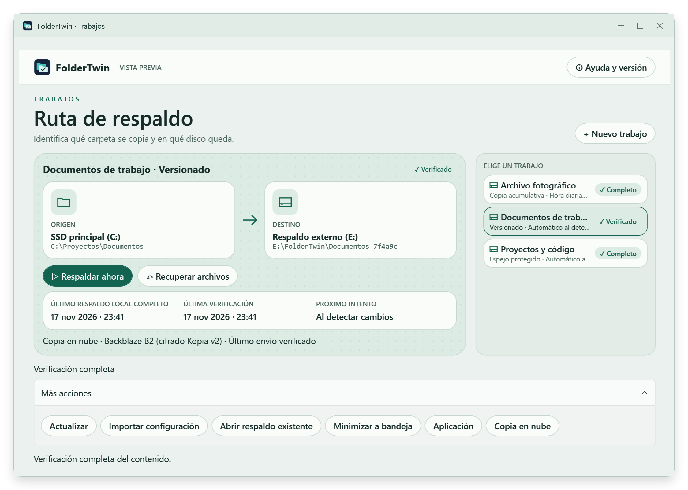

<p align="center">
  
</p>

<h1 align="center">FolderTwin</h1>

<p align="center">
  <strong>Copias locales verificadas, versiones recuperables y tercera copia cifrada para Windows 11.</strong><br>
  <sub>Escrito en C# y .NET 10 sobre primitivas nativas NTFS, sin dependencias NuGet externas ni bloqueo propietario.</sub>
</p>

<p align="center">
  <a href="https://mikepchelper-spec.github.io/FolderTwin/"></a>
  <a href="https://github.com/mikepchelper-spec/FolderTwin/actions/workflows/copy-probe.yml"></a>
  <a href="global.json"></a>
  <a href="LICENSE"></a>
  <a href="https://www.paypal.me/atlaspcsupport"></a>
</p>

<p align="center">
  <a href="https://mikepchelper-spec.github.io/FolderTwin/">Sitio web</a> ·
  <a href="GUIA.md">Guía de uso</a> ·
  <a href="PLAN.md">Arquitectura</a> ·
  <a href="HISTORIAL.md">Historial y prácticas</a> ·
  <a href="V1.md">Matriz v1</a> ·
  <a href="https://www.paypal.me/atlaspcsupport"><strong>Donar con PayPal</strong></a>
</p>

<p align="center">
  <picture>
    <source media="(prefers-color-scheme: dark)" srcset="assets/hero-dark.png">
    <source media="(prefers-color-scheme: light)" srcset="assets/hero-light.png">
    
  </picture>
</p>

> [!WARNING]
> **Vista previa experimental (Windows 11 x64):** el software está verificado sobre datos sintéticos, inyección de fallos y volúmenes virtuales desechables, pero el piloto externo de 7–14 días, los discos USB físicos y las cuentas reales de nube siguen pendientes en [V1.md](V1.md). Úsalo solo con carpetas de prueba desechables; no operes aún sobre respaldos personales ni destinos de FreeFileSync.

---

## Tres modos de protección bajo un mismo motor

FolderTwin separa **cómo se conserva tu información** del **momento en que se ejecuta** (a demanda, horario diario en el Programador de tareas de Windows o vigilancia continua `FileSystemWatcher` con comparación acotada):

- **Versionado por fecha *(recomendado)*:** almacena objetos inmutables deduplicados por contenido (`objects/sha256/ab/<digest>`) y catálogos JSONL duplicados (hasta `512 MiB` y `350 000` entradas por punto), permitiendo comparar fechas y restaurar archivos modificados o eliminados.
- **Copia acumulativa:** añade y actualiza archivos en una carpeta navegable conservando todo lo exclusivo del destino; si un archivo previo sufre borrado externo o *bitrot* en el disco de respaldo, detiene la publicación con conflicto explícito antes de pisar estado bueno.
- **Espejo protegido:** mantiene un reflejo directo del origen guardando antes en versiones recuperables cualquier archivo sustituido o retirado, exigiendo revisión explícita ante orígenes vacíos o retiradas masivas.
- **Tercera copia cifrada opcional (3-2-1):** publica puntos confirmados en repositorios cifrados **Kopia `0.23.1`** sobre S3 / Backblaze B2 o mediante puente local **rclone `1.76.0`** (`127.0.0.1`), conservando `Zone.Identifier` (`layout 2`) y permitiendo restaurar todo o archivos sueltos desde un perfil en blanco.

---

## Estado real y garantías de ingeniería

| Componente | Lo que ya está implementado y verificado | Referencias |
| --- | --- | --- |
| **Motor NTFS (`src/FolderTwin.Core`)** | Cerca nativa por handles (`DirectoryFence`), identidades físicas de 24 bytes (`FILE_ID_INFO`) y `VOLUME_NAME_GUID` inmunes a cambios de letra; restauración limpia mediante staging oculto sin residuos `.foldertwin-*`; registro replicado de generaciones con archivo histórico encadenado y reparación de colas tras corte abrupto; retención manual con cuarentena reversible y purga tras plazo de gracia | [Plan técnico](PLAN.md) · [Versiones](docs/VERSIONES.md) · [Retención](docs/RETENCION.md) · [Espejo](docs/ESPEJO.md) · [Acumulativa](docs/ACUMULATIVA.md) |
| **Escritorio WPF (`src/FolderTwin.App`)** | Ejecutable puro **`FolderTwin.exe`** aislado de código de pruebas; vista **Ruta de respaldo**, asistente en 4 pasos, 100 controles con ayuda contextual (`F1`), apertura independiente sin origen (**Abrir respaldo existente**), índice local SQLite en solo lectura durante navegación (`329 000` rutas en `~3,5 s`), temas claro/oscuro/Alto Contraste y bandeja opcional | [Guía de uso](GUIA.md) · [Controles de ayuda](AYUDA-CONTROLES.md) · [Instalación](INSTALACION.md) |
| **Nube cifrada y distribución** | Staging fuera de `C:` en el volumen del almacén local, cachés Kopia acotadas a `64 MiB`, inventario CycloneDX `1.6` (`COMPONENTES.json`), manifiesto `SHA256SUMS.txt`, fuentes exactas incluidas (`FolderTwin-source.tar`) y ZIP portable 100 % determinista entre compilaciones independientes | [Nube](NUBE.md) · [Recuperación de emergencia](RECUPERACION-NUBE.md) · [Seguridad](SEGURIDAD-DISTRIBUCION.md) |
| **Validaciones externas abiertas** | Piloto supervisado de 7–14 días, desconexión física en USB NTFS, ciclos reales de energía/sesión/reinicio de Windows, cuentas reales en proveedores de nube, lector de pantalla activo y escalado multimonitor físico | [Matriz v1](V1.md) · [Piloto](PILOTO.md) · [Historial y mediciones](HISTORIAL.md) |

---

## Inicio rápido

### Usar el paquete portable
Extrae el ZIP portable completo en una carpeta nueva y ejecuta **`FolderTwin.exe`**. El paquete incluye el runtime `.NET 10.0.15`, licencias, guías offline y herramientas fijadas de nube (`cloud-tools/`). Consulta [GUIA.md](GUIA.md), [INSTALACION.md](INSTALACION.md) y [COMPATIBILIDAD.md](COMPATIBILIDAD.md).

### Compilar y verificar desde el código fuente
Con Windows 11 x64, PowerShell 7 y el SDK fijado en [global.json](global.json) (`.NET SDK 10.0.404`):

```powershell
# 1. Compilar motor, aplicación WPF y suites de prueba
dotnet build FolderTwin.sln -c Release

# 2. Ejecutar suites sintéticas del motor y de la interfaz
dotnet run --project tests/CopyProbe -c Release -- --product-store
dotnet run --project tests/CopyProbe -c Release -- --accumulative
dotnet run --project tests/CopyProbe -c Release -- --retention
dotnet run --project tests/CopyLab.Tests -c Release -- --product-smoke

# 3. Publicar y verificar un paquete portable reproducible fuera del repositorio
.\scripts\Publish-Portable.ps1 -OutputDirectory "$env:TEMP\FolderTwin-win-x64"
.\scripts\New-PortableZip.ps1 -PackageDirectory "$env:TEMP\FolderTwin-win-x64" -ZipPath "$env:TEMP\FolderTwin-win-x64.zip" -SourceRevision (git rev-parse HEAD)
.\scripts\Test-Portable.ps1 -PackageDirectory "$env:TEMP\FolderTwin-win-x64" -SourceRevision (git rev-parse HEAD)
```

---

## Estructura del repositorio

```text
FolderTwin/
├── FolderTwin.sln                 # Solución raíz (producción + suites de validación)
├── src/
│   ├── FolderTwin.Core/           # Motor NTFS, objetos SHA-256, catálogos JSONL, retención y nube
│   └── FolderTwin.App/            # Aplicación WPF (FolderTwin.exe) y trabajadores en segundo plano
├── tests/
│   ├── CopyProbe/                 # 34 suites sintéticas de motor, concurrencia, escala e inyección de fallos
│   ├── CopyLab.Tests/             # Pruebas automatizadas de interfaz WPF, temas, SQLite y vigilancia
│   ├── AutomationAcceptance/      # Auditoría binaria del paquete, fallos de nube y alias de volumen
│   └── CompatibilityProbe/        # Verificación cruzada frente a entregas anteriores
├── docs/                          # Especificaciones de formato (CATALOG, VERSIONES, RETENCION, ESPEJO…)
├── scripts/                       # Publicación reproducible, ZIP determinista y verificación CycloneDX
└── site/                          # Sitio estático de presentación (GitHub Pages)
```

---

## Apoya el proyecto

FolderTwin es software libre creado dentro del ecosistema de **Atlas PC Support**, sin telemetría, anuncios ni suscripciones forzadas. Si valoras las herramientas locales honestas para Windows y quieres apoyar el tiempo de ingeniería y el laboratorio de pruebas físicas:

<p align="left">
  <a href="https://www.paypal.me/atlaspcsupport">
    
  </a>
</p>

---

## Licencia y comunidad

Distribuido bajo licencia **[GNU GPL v3 o posterior](LICENSE)**. Consulta [SUPPORT.md](SUPPORT.md), [SECURITY.md](SECURITY.md), [CONTRIBUTING.md](CONTRIBUTING.md) y [MANTENIMIENTO.md](MANTENIMIENTO.md).
