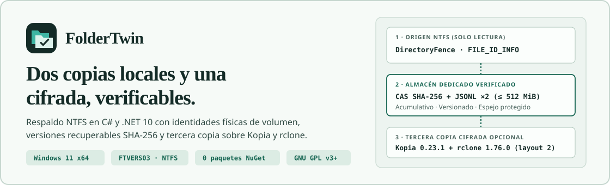

<p align="center">
  
</p>

<p align="center">
  <a href="https://mikepchelper-spec.github.io/FolderTwin/"></a>
  <a href="LICENSE"></a>
  <a href="global.json"></a>
  <a href="https://www.paypal.me/atlaspcsupport"></a>
</p>

<p align="center">
  <strong><a href="https://mikepchelper-spec.github.io/FolderTwin/">Sitio de presentación</a></strong> ·
  <a href="GUIA.md">Guía de uso</a> ·
  <a href="PLAN.md">Arquitectura y seguridad</a> ·
  <a href="HISTORIAL.md">Historial, retos y prácticas</a> ·
  <a href="V1.md">Matriz v1</a> ·
  <a href="https://www.paypal.me/atlaspcsupport"><strong>Donar vía PayPal ↗</strong></a>
</p>

> **Vista previa experimental para Windows 11 x64:** usa únicamente datos sintéticos y carpetas desechables. Las pruebas sintéticas, de inyección de fallos y de volúmenes virtuales VHDX verifican el comportamiento lógico del software, pero **no garantizan** recuperación ante cortes eléctricos físicos, fallos de hardware/firmware ni durabilidad en proveedores externos. No operes sobre respaldos personales ni sobre destinos de FreeFileSync.

---

## Qué hace diferente a FolderTwin

FolderTwin protege carpetas en Windows 11 combinando **identidad física de volúmenes NTFS** (`VOLUME_NAME_GUID` + `FILE_ID_INFO` por handle nativo), **almacén inmutable de objetos `SHA-256`**, **catálogos JSONL duplicados** y **tercera copia cifrada opcional** sobre **Kopia 0.23.1** y **rclone 1.76.0**, sin depender de paquetes NuGet externos ni atar tus datos a una base propietaria.

| Área | Estado real verificado | Documentación |
| --- | --- | --- |
| **Motor local (`src/FolderTwin.Core`)** | **Copia acumulativa** (con detección de borrado externo y *bitrot*), **Versionado por contenido `SHA-256`** y **Espejo protegido**; comparación rápida acotada (`Scoped`) en los tres modos; restauración limpia mediante staging oculto sin residuos `.foldertwin-*`; conservación de `Zone.Identifier` (hasta 16 KiB); registro replicado de generaciones con archivo histórico encadenado; retención manual con cuarentena reversible y purga tras gracia | [Plan técnico](PLAN.md) · [Versiones](docs/VERSIONES.md) · [Retención](docs/RETENCION.md) · [Espejo](docs/ESPEJO.md) · [Acumulativa](docs/ACUMULATIVA.md) |
| **Aplicación WPF (`src/FolderTwin.App`)** | Ejecutable puro **`FolderTwin.exe`** aislado de arneses de prueba; vista **Ruta**, asistente de cuatro pasos, 100 controles con ayuda contextual (`F1`), recuperación sin origen o desde perfil vacío (**Abrir respaldo existente**), índice local SQLite en solo lectura durante navegación, soporte de temas claro/oscuro/Alto Contraste, bandeja opcional y vigilancia/horarios con el Programador de tareas de Windows | [Guía de uso](GUIA.md) · [Controles de ayuda](AYUDA-CONTROLES.md) · [Instalación](INSTALACION.md) |
| **Tercera copia cifrada (3-2-1)** | Repositorio cifrado Kopia `0.23.1` (`layout 2` con catálogo verificado) sobre S3 o pasarela local `rclone` `1.76.0` (`127.0.0.1`), preparación temporal en el volumen del respaldo local (fuera de `%LOCALAPPDATA%`), cachés acotadas a 64 MiB, cola durable de envíos y recuperación completa o selectiva sin perfil previo | [Nube](NUBE.md) · [Recuperación de emergencia](RECUPERACION-NUBE.md) · [Seguridad de distribución](SEGURIDAD-DISTRIBUCION.md) |
| **Ingeniería y suite (`tests/`)** | Solución `FolderTwin.sln` con separación estricta `src/` vs `tests/` (`CopyProbe`, `CopyLab.Tests`, `AutomationAcceptance`, `CompatibilityProbe`) y distribución portable determinista verificable bit a bit | [Historial y prácticas](HISTORIAL.md) · [Contribuir](CONTRIBUTING.md) · [Aceptación](tests/AutomationAcceptance/README.md) |
| **Validaciones externas** | **Pendientes antes de cerrar v1 estable:** piloto de 7–14 días, USB NTFS físico, ciclos reales de energía/sesión/reinicio de Windows, otra cuenta o equipo, cuentas reales en proveedores de nube, lector de pantalla activo y escalado/DPI físico | [Matriz v1](V1.md) · [Piloto](PILOTO.md) |

---

## Uso del paquete portable

Extrae el contenido completo del ZIP portable en una carpeta nueva y abre **`FolderTwin.exe`**. El paquete incluye el runtime de `.NET 10.0.15`, `COMPONENTES.json` (CycloneDX 1.6), `SHA256SUMS.txt`, las herramientas fijadas de nube (`cloud-tools/kopia.exe` y `cloud-tools/rclone.exe` cuando se empaqueta con soporte de nube), las licencias, las guías offline y las fuentes exactas del commit (`FolderTwin-source.tar`).

- [Guía de uso](GUIA.md) · [Notas del candidato](NOTAS.md) · [Instalación y actualización](INSTALACION.md) · [Compatibilidad](COMPATIBILIDAD.md)
- [Recuperación desde nube](RECUPERACION-NUBE.md) · [Soporte](SUPPORT.md) · [Seguridad](SECURITY.md) · [Mantenimiento](MANTENIMIENTO.md)

---

## Compilación y verificación desde el código fuente

Instala el SDK fijado en [global.json](global.json) (`.NET SDK 10.0.404`) y ejecuta en PowerShell 7 sobre Windows:

```powershell
# Compilar toda la solución (motor, aplicación y arneses de prueba)
dotnet build FolderTwin.sln -c Release

# Ejecutar pruebas sintéticas del motor local
dotnet run --project tests/CopyProbe -c Release -- --product-store
dotnet run --project tests/CopyProbe -c Release -- --accumulative
dotnet run --project tests/CopyProbe -c Release -- --retention

# Ejecutar pruebas sintéticas de interfaz WPF, temas y accesibilidad
dotnet run --project tests/CopyLab.Tests -c Release -- --product-smoke
```

Para generar y comprobar el paquete portable reproducible fuera del árbol del repositorio:

```powershell
.\scripts\Publish-Portable.ps1 -OutputDirectory "$env:TEMP\FolderTwin-win-x64"
.\scripts\New-PortableZip.ps1 -PackageDirectory "$env:TEMP\FolderTwin-win-x64" -ZipPath "$env:TEMP\FolderTwin-win-x64.zip" -SourceRevision (git rev-parse HEAD)
.\scripts\Test-Portable.ps1 -PackageDirectory "$env:TEMP\FolderTwin-win-x64" -SourceRevision (git rev-parse HEAD)
```

---

## Estructura del repositorio

- `FolderTwin.sln`: solución raíz con proyectos de producción (`src/`) y validación (`tests/`).
- `src/FolderTwin.Core/`: motor de copia, catálogos JSONL duplicados ([CATALOG.md](docs/CATALOG.md)), almacén de objetos SHA-256 ([VERSIONES.md](docs/VERSIONES.md)), espejo ([ESPEJO.md](docs/ESPEJO.md)), copia acumulativa ([ACUMULATIVA.md](docs/ACUMULATIVA.md)), retención ([RETENCION.md](docs/RETENCION.md)), `Zone.Identifier` ([ZONE-IDENTIFIER.md](docs/ZONE-IDENTIFIER.md)) y conectores de nube.
- `src/FolderTwin.App/`: aplicación de escritorio WPF (`FolderTwin.exe`) y trabajadores en segundo plano.
- `tests/`: suites sintéticas separadas (`CopyProbe`, `CopyLab.Tests`, `AutomationAcceptance` y `CompatibilityProbe`).
- `docs/`: especificaciones técnicas de formatos, diarios, ejecución ([EJECUCION.md](docs/EJECUCION.md)), configuración ([CONFIGURACION.md](docs/CONFIGURACION.md)) y estados pendientes ([PENDIENTES.md](docs/PENDIENTES.md), [PENDING.md](docs/PENDING.md)).
- `site/` y `assets/`: página web estática de presentación para GitHub Pages y recursos gráficos del repositorio.
- `scripts/`: publicación reproducible (`Publish-Portable.ps1`), compresión determinista (`New-PortableZip.ps1`) y verificación de integridad/SBOM (`Test-Portable.ps1`).

---

## Apoya el proyecto

FolderTwin es software libre desarrollado dentro del ecosistema de **Atlas PC Support**, sin telemetría, anuncios ni suscripciones. Si este trabajo te aporta valor o quieres impulsar las pruebas en laboratorio físico y nuevas entregas, puedes invitar un café o hacer una donación voluntaria:

- **Donar vía PayPal:** [https://www.paypal.me/atlaspcsupport](https://www.paypal.me/atlaspcsupport)

---

## Licencia

Distribuido bajo [GNU GPL versión 3 o posterior](LICENSE).
